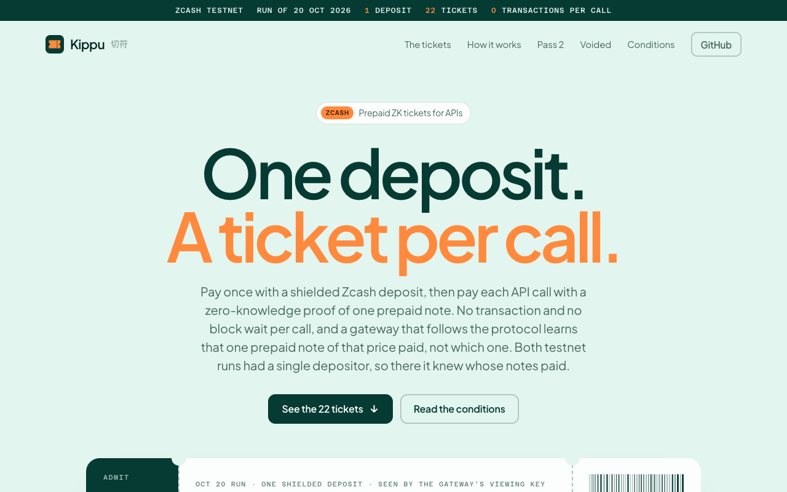

# Kippu — pay per API call on Zcash with ZK tickets



Live: the landing at https://kippu-landing.vercel.app and the run record (dashboard) at
https://kippu-dashboard.vercel.app, both static over the published runs. A hosted gateway answers the
402 challenge at https://kippu-api.201-18-198-162.sslip.io/api/info (and `/api/quote`), but it has no
wallet to anchor roots (Setup required: `Z402_WALLET`, `Z402_ANCHOR_SIGNING_KEY`), so no client can pay
it yet. Locally the landing is `packages/landing/index.html` and the dashboard is
`pnpm --filter @z402/dashboard dev`. Try it (Node 22.13+, pnpm 10, Rust 1.89; no wallet, no transaction):

```sh
pnpm install && pnpm build             # the first build compiles the Rust scanner (minutes, cold)
pnpm --filter @z402/examples demo      # about 20 s: both testnet runs replayed by the shipped client
```

**Pay once with a shielded Zcash deposit, then pay per API call with a zero-knowledge proof.** No
transaction and no block wait per call; a gateway that follows the protocol learns that *one* prepaid
note of that price paid, not which one. Both testnet runs had a single depositor, so there the gateway
knew whose notes paid, only not which of them (see [limits](#honest-limits) for what a dishonest one can do).

Zcash has no contracts, so null-402's on-chain Groth16 pool can't be ported. Here **the gateway is
the pool**: it credits notes only for a deposit its own viewing key sees on-chain (the memo commits
to every note and value), verifies each call's Groth16 proof off-chain, burns nullifiers, and
anchors its state in a signed shielded memo to a public-viewing-key address. Clients prove only
against a root they have read themselves in a recent on-chain anchor, and scan the anchor address
over their window: a gateway cannot hand a client its own root without putting a separate root
on-chain, signed with its key, which clients refuse (`ANCHOR_COMPETING`). The gateway is trusted for
liveness, its nullifier set and to keep anchoring; clients trust their lightwalletd for the anchors
(see [docs](packages/docs/README.md)).

## Live on Zcash testnet

Run of 2026-10-20 (`deployments/testnet.json`), before anchored roots and signed anchors (the
pre-anchored-root protocol). 1 unit = 1,000 zat; a call costs 10 units.

| Step | Result | Tx |
|---|---|---|
| demo payer funded from a demo wallet | 300,000 zat | [`0f8186c6…`](https://testnet.zecblock.com/tx/0f8186c62a7f89d79988a43ad511c8b466a530e7f741f130c10532df605651db) |
| one shielded deposit for 22 notes (`z402:<commitment>`) | 220,000 zat at block 4,522,696, seen by the gateway's viewing key | [`05c57a3b…`](https://testnet.zecblock.com/tx/05c57a3b074c7141a1052ca5197743a5140d5f4fa6178cd3d4894391ffd42a6f) |
| claim | 22 notes credited, root `449878737549…` | — |
| second claim of the same deposit | refused (409) | — |
| claim with an altered note value (fresh gateway) | refused: `MEMO_MISMATCH, AMOUNT_TOO_LOW` | — |
| **20 paid calls** | **20 × HTTP 200, no transaction**, client proofs 346–569 ms | — |
| 2 more paid calls with the fixture notes (then used for the attacks below) | 2 × HTTP 200 → 22 notes spent | — |
| replay of a paid proof | `NULLIFIER_SPENT` | — |
| changed amount; a proof made for another request | both `NOT_BOUND_TO_CHALLENGE` | — |
| changed nullifier | `BAD_PROOF` | — |
| anchor (`z402:anchor:22:<root>:22:<nullifier-set hash>`: 22 leaves, 22 spent) | memo found with the anchor viewing key; equals the gateway's root and nullifier set | [`a0992237…`](https://testnet.zecblock.com/tx/a09922378bb7d404c31ac9226fee2de5664a920483d714b1b811647717501395) |

Fixture notes: two of the 22 notes were spent in the run and their secrets published, so tests in a
fresh clone can claim the real deposit on a fresh gateway and pay with real proofs.

### Pass 2 live on testnet (Oct 22, 2026): the current protocol

`pnpm --filter @z402/examples pass2` (`deployments/testnet-pass2.json`): a fresh gateway (new SQLite database,
`Z402_AUTO_ANCHOR` on, a new anchor signing key `ac1c23e8…`) and a client with the default
window that pins that key. Demo wallets only.

| Step | Result | Tx |
|---|---|---|
| the gateway demo wallet funds the payer | 2 × 60,000 zat | [`64759b2a…`](https://testnet.zecblock.com/tx/64759b2a3da3a2ba875bc6d351af5750bad3c03000abb4408e509cbb1ae141b9) |
| deposit 1: 3 notes of 10 units in one shielded tx | 30,000 zat at block 4,529,569, mined 21 s after it was sent; claimed | [`90f70d6a…`](https://testnet.zecblock.com/tx/90f70d6a79edafb8ec5fb4f0c845aab0af9b56a90b3d51d01800c11783c6c9d4) |
| auto-anchor after the claim (3 leaves, 0 spent, signed) | block 4,529,574 | [`c69195a9…`](https://testnet.zecblock.com/tx/c69195a9741da0d8b3150cbb2803621e6685af4076875cbca96292a1797223c5) |
| **3 paid calls** through `Z402Client`, default 2,880-block window, pinned anchor key | **3 × HTTP 200**, proofs 548, 351, 361 ms; the first **2 min 44 s after the deposit was sent** | — |
| anchor after the spent count changed (3 leaves, 3 spent) | block 4,529,584 | [`f75213bb…`](https://testnet.zecblock.com/tx/f75213bbee1ac7597278b273f2bc5d0a25195f59a5ec22411765ce343a070abd) |
| deposit 2: 3 more notes | block 4,529,584; claimed from leaf 3 | [`27ce212c…`](https://testnet.zecblock.com/tx/27ce212c7acf1bd4a2e715aadad68b77ab46cb6b3a492a9e9113e7b1a37e515c) |
| auto-anchor (6 leaves, 3 spent) | block 4,529,589 | [`c1b4b478…`](https://testnet.zecblock.com/tx/c1b4b4780788fd466bff11c87aff1cb9ae3e644b2443d7941ced1649ed46ab39) |
| a proxy names the 3-leaf anchor to a client whose note is leaf 3 | HTTP 200 against the 6-leaf anchor the client found itself (the client before this round would have refused `NOTE_NOT_ANCHORED`, telling the gateway where the note was) | — |
| one more paid call | HTTP 200, proof 574 ms | — |
| end-state anchor (6 leaves, 5 spent) | block 4,529,599 | [`4265af65…`](https://testnet.zecblock.com/tx/4265af65ce017a63cda24f78e397e3676d9df402058165900ea0719fa32078ff) |
| the operator turns dishonest: a second root for 6 leaves (last leaf swapped), signed with the gateway key | block 4,529,606 | [`3ed5319c…`](https://testnet.zecblock.com/tx/3ed5319c06e9e12831b53d779b2bb802f26e2d3fc3c7251062eacb90ce19484c) |
| a client checks seconds after that block | paid (HTTP 200): its scan did not include the block yet | — |
| the same check once its scan shows the block | **`ANCHOR_COMPETING`**, nothing proven | — |

Deposit to first paid call was measured, not estimated: the anchor send took 49 s (zingo-cli) and the anchor was mined
5 blocks after the deposit. Detection of a competing anchor lags by as much as the client's lightwalletd does: a
payment made before its scan includes the block goes through. After the competing anchor, every client with this
deployment in its window refuses it; that is the point of the step. The run's one leftover note (leaf 5) is published
as a fixture so a fresh clone can replay the run (`packages/sdk/test/pass2.test.ts`, and step 5 of `demo`): a gateway
rebuilt from its two deposits and four anchors, and a pinned-key client with the default 2,880-block window that
judges the chain as of block 4,529,604 (`replayAtHeight`), pays against the newest signed anchor `4265af65…`; as of the
record's last block (4,529,619) it refuses `ANCHOR_COMPETING`. That is a replay at a pinned height. No gateway of the
current protocol is anchoring live, so a fresh clone cannot make a live payment under the current protocol; the live
ones are the four calls and the probe above.

## Packages

| Package | What |
|---|---|
| [`packages/circuits`](packages/circuits) | `Payment(20)` with the value-bound leaf (from near-null-402), this repo's own setup (vk `8e7fa586…`), deposit commitments |
| [`packages/gateway`](packages/gateway) | the pool run by the gateway: deposits via viewing key, tree, off-chain Groth16, nullifiers, anchors, HTTP; state in SQLite |
| [`packages/scan`](packages/scan) | `zpay-verify` (copy) for the viewing-key checks, plus `scan-range` to find every anchor in a block range |
| [`packages/sdk`](packages/sdk) | `Z402Client`: plan, claim, pay (only its gateway; only against the newest anchored root it finds on-chain, signed with the pinned key), status |
| [`packages/mcp`](packages/mcp) | `z402-mcp`: status, deposit, claim, pay |
| [`packages/examples`](packages/examples) | the resumable live runs above (`run-live`, `pass2`) and `demo` |
| [`packages/agent`](packages/agent) | an LLM agent (opencode) paying through `z402-mcp` against a local gateway |
| [`packages/dashboard`](packages/dashboard) | chain vs calls, who sees what, refusals, anchor recomputed in the browser |
| [`packages/docs`](packages/docs) | why no on-chain verifier, flow, anonymity set, trust model |
| [`packages/landing`](packages/landing) | one-page landing |

## Run it

Needs Node 22.13+ (`node:sqlite`), pnpm 10, Rust 1.89 (pinned in `packages/scan`), circom 2.2 only to redo the setup.
`protoc` is optional: the scanner's `zcash_client_backend` uses its pre-generated lightwalletd bindings when no
`protoc` is on the PATH (its `build.rs`); CI installs it anyway. That fallback was read in the crate's build script, not
tried on a machine without `protoc`.

```sh
pnpm install
pnpm build                         # the Rust scanner (cargo) and the TypeScript packages
pnpm --filter @z402/examples demo  # about 20 s (19.8 and 20.5 s on Oct 23), no transaction: the shipped client against gateways rebuilt from both runs
pnpm test                          # 106 tests + doc: scan 3 + doc, circuits 6 (local); gateway 50 + sdk 38 + mcp 9 (most against live testnet)
pnpm --filter @z402/dashboard dev  # http://localhost:5183
Z402_FUNDER_WALLET=<demo wallet> pnpm --filter @z402/examples run-live   # the Oct 20 run
pnpm --filter @z402/examples pass2                                      # the Oct 22 run (demo wallets from run-live)
```

`demo` prints (Oct 23; the live ages in steps 1 and 2 grow with the chain, the replays do not):

```text
1. a fresh gateway claims the Oct 20 deposit 05c57a3b074c… (22 notes, 220,000 zat)
   its viewing key saw the deposit on testnet: 22 notes credited, root 44987873754930…
   it adopts the Oct 20 anchor a09922378bb7… (block 4522706, 7503 blocks old), read with the published anchor key

2. a live client with the default window (2880 blocks) pays /api/quote
   refusing to pay: ANCHOR_TOO_OLD: anchor a09922378bb7… was mined 7503 blocks ago; this client accepts at most 2880

3. a dishonest gateway in front of it serves this client its own leaf list and root, with no anchor
   refusing to pay: UNANCHORED_ROOT: the gateway offers root 811732075488… with no on-chain anchor  (no proof was made, nothing sent)

4. a replay of the Oct 20 run as of block 4522716 (10 blocks after its anchor), default window: the scan range is fixed, so this does not slow down as the chain grows. Its anchor is unsigned (that run predates signed anchors)
   GET /api/quote → 402 → proof 542 ms → HTTP 200, nullifier 347714795794…, against anchor a09922378bb7… (22 leaves)
   GET /api/quote → 402 → proof 353 ms → HTTP 200, nullifier 980511180841…, against anchor a09922378bb7… (22 leaves)
   the gateway burned 2 nullifiers; no transaction was sent for either call
   a third call: no unspent note of exactly 10 units (a note pays one call of its full value)

5. the Oct 22 pass-2 run (current protocol, signed anchors, key ac1c23e8af09… pinned from the record): a fresh gateway credits its two deposits and adopts its four anchors
   root matches the record; newest anchor 4265af65ce01… at block 4529599
   a live client (current tip, default window):
   refusing to pay: ANCHOR_COMPETING: anchor 3ed5319c06e9… at height 4529606 (6 leaves, root 165039324883…) is not on the leaf history this gateway serves (6 leaves): it has anchored conflicting roots, signed with its own key
   replayed as of block 4529604 (after the newest honest anchor, before the competing one), default window:
   GET /api/quote → 402 → proof 372 ms → HTTP 200, nullifier 948329307016…, against signed anchor 4265af65ce01… (6 leaves, block 4529599)
   replayed as of block 4529619 (the record's end, after the competing anchor at 4529606):
   refusing to pay: ANCHOR_COMPETING: anchor 3ed5319c06e9… at height 4529606 (6 leaves, root 165039324883…) is not on the leaf history this gateway serves (6 leaves): it has anchored conflicting roots, signed with its own key
   no gateway of the current protocol is anchoring live for a clone to pay; the live signed-anchor payments are the ones recorded in deployments/testnet-pass2.json

done in 19.8 s
```

The time is bounded: the replays scan fixed block ranges (2,881 blocks ending at a pinned height), and the two live
checks scan the default 2,880-block window back from the tip, whatever the tip is. Before this round the replay
widened its window to the anchor's age, so it scanned about 1,150 more blocks every day (16.7 s at 7,297 blocks on
Oct 23).

Demo video: `zec-null-402-demo.mp4` (shared separately until hosted). It was recorded on Oct 20, before
the Oct 21 review fixes, the Oct 22 anchored-root changes and the Oct 23 replays below; it shows the old client,
paying under a window widened on purpose. A new recording of `demo` is still to be made.

### Review fixes (Oct 21, 2026)

A strict review ([docs/JUDGE-2026-10-21.md](docs/JUDGE-2026-10-21.md)) found that the Oct 20 gateway
could be made to pay twice. Each fix has a test that fails on the old code:

| Was possible | Now |
|---|---|
| a spent note paid again with its nullifier written `0<n>` or in hex (snarkjs parses both) | public signals must be canonical decimal, else `MALFORMED_SIGNALS` |
| one payment, or two proofs of one note, sent at once were all paid | challenge and nullifier reserved before the proof check |
| two concurrent claims of one deposit both credited it | a deposit is locked while it is scanned |
| a server could relay the gateway's challenge and redeem the agent's proof | the SDK pays only its gateway, for the path asked, to the gateway's `payTo` |
| any web page could make the gateway send anchor transactions | `POST /api/anchor` needs `Authorization: Bearer $Z402_ADMIN_TOKEN` |
| `/api/info` served the deposit viewing key | it no longer does |
| unpaid challenges and request bodies were unbounded | 10,000 challenges, 64 KiB bodies (since Oct 23 a challenge stores nothing, see below) |

The live run's results above are unchanged: they never used these paths.

### Review fixes, pass 2 (Oct 22, 2026): prove only against anchored roots

The review's open gap: clients proved against whatever root the gateway handed them, so a dishonest
gateway could give each client its own leaf list and tell clients apart by the root in their proofs.

| Was possible | Now |
|---|---|
| a gateway serves one client its own leaf list and root | the client reads the anchor the challenge names from lightwalletd with the anchor address's published viewing key (pinned in the client, `Z402_ANCHOR_UIVK`), needs a memo for exactly that leaf count and root, mined, at most 2,880 blocks old (`Z402_MAX_ANCHOR_AGE_BLOCKS`), and rebuilds that root from the leaves served; it proves against the anchored tree only. Otherwise it refuses before proving: `UNANCHORED_ROOT`, `ANCHOR_MISMATCH`, `ANCHOR_NOT_CONFIRMED`, `ANCHOR_TOO_OLD`, `LEAVES_NOT_ANCHORED` |
| leaves added for one client after the anchor change that client's root | they never enter the proof: every client proves against the anchored root |
| a gateway shows a client a rolled-back or rewritten history | the client remembers the last anchor it accepted: `ANCHOR_ROLLBACK`, `ANCHOR_FORK` |
| a restart lost every outstanding challenge; two gateway processes on one state file both paid one note | state in SQLite: challenges, nullifiers, deposits, anchors survive a restart; the challenge `DELETE … RETURNING` (since Oct 23 an upsert on answered nonces) and the nullifier primary key decide between processes |

Each with tests that fail on `a8aa033` ([TESTING.md](TESTING.md)). The cost: a new note can pay only
after the next anchor is mined (`Z402_AUTO_ANCHOR=1` anchors after every credited deposit). Tests replay
the Oct 20 anchor (`a0992237…`) as of 10 blocks after it with the default window (`replayAtHeight`, since
Oct 23; before, a window of its age + 10 blocks); a live client refuses it, which a test shows. The Oct 20 run predates this: its calls were proven against the gateway's current
root, anchored after the calls. The current protocol has since run live (pass 2 above).

### Review fixes, pass 3 (Oct 22, 2026, ultra round)

Two more judges reviewed `773ffc5`. Each code fix has a test that fails on `773ffc5` ([TESTING.md](TESTING.md)):

| Was possible | Now |
|---|---|
| a gateway anchors a separate root for one client, and a first-time client accepts it; anchor memos were unsigned, so nobody could tell who sent one | anchors are signed with the gateway's Ed25519 key (`Z402_ANCHOR_SIGNING_KEY`; clients pin the public key, `Z402_ANCHOR_PUBKEY`); the client scans the anchor address over its window (`zpay-verify scan-range`) and refuses two signed anchors not on one leaf history: `ANCHOR_COMPETING`; an unsigned anchor with a pinned key: `ANCHOR_BAD_SIGNATURE` |
| a gateway steps a payer through older anchors and watches for `NOTE_NOT_ANCHORED` to learn which deposit its note is in | the client proves against the newest anchor in its window, whichever one is named |
| a quiet gateway becomes unpayable after 2,880 blocks; a failed auto-anchor was only logged | `Z402_AUTO_ANCHOR=1` re-anchors every `Z402_ANCHOR_EVERY_BLOCKS` (1,440), after credited deposits and spent-count changes, and retries failed sends every 60 s; MCP `pay` waits on `ANCHOR_TOO_OLD` and `ANCHOR_NOT_CONFIRMED` too |
| two anchor sends at once on one zingo wallet; a sent anchor lost if recording failed | one send at a time (later calls share one follow-up), a lockfile per wallet directory, the txid reported if it cannot be recorded |
| `pay(url)` fetched any URL and returned its body to the agent | nothing outside the gateway's origin is fetched; no redirects |
| concurrent MCP calls overwrote the notes file (a claim in flight erased a new plan's secrets) | every change re-reads the file under a lock (in-process and an O_EXCL lockfile), fsync before rename; payments at once use different notes; a sent deposit's txid is saved at once |
| `Z402_UNIT_ZAT=` (blank) credited notes for 0 zat; `Z402_MAX_ANCHOR_AGE_BLOCKS=2,880` switched the age check off | whole-number settings fail closed: blank is the default, malformed is Setup required (exit 2) |
| every request read every table; one challenge bought unlimited proof checks; unlimited scanner processes; text/plain claims from any web page | counts only; 3 proof checks per challenge; 4 scans at once (503 + `Retry-After`); claims and anchor requests must be JSON (415); the verification key is parsed once |
| a per-deposit cap only | `Z402_MAX_TOTAL_DEPOSIT_ZAT` caps a notes file's deposits together (reserved under the notes-file lock since Oct 23) |

Copy fixed with them: the agent's buy-the-report order is attributed to the operator's prompt (not a quote response),
the Oct 20 double credit is disclosed, the root-partitioning claim is qualified, the transaction count says per run, and
lightwalletd is named as trusted. No restyle: the same components and classes.

### Review fixes, pass 4 (Oct 23, 2026, second ultra round)

Two more judges reviewed `4811fb1`. Each code fix has a test that fails on `4811fb1` ([TESTING.md](TESTING.md)):

| Was possible | Now |
|---|---|
| after accepting a newer anchor, a client refused `ANCHOR_ROLLBACK` when the gateway still named an older one of the same history | the rollback check compares the anchor the client proves against (the newest in its window), so it pays |
| the gateway's anchor check ran the scan binary synchronously (`execFileSync`, no timeout): a slow lightwalletd froze every request, and a junk tip became `NaN`, meaning "never re-anchor" | the tip is read asynchronously with a 30 s timeout, and anything but a whole block height is an error |
| two `deposit` calls at once both passed `Z402_MAX_TOTAL_DEPOSIT_ZAT` | the budget is checked and reserved under the notes-file lock that inserts the plan; unsent plans count |
| `/api/info` listed every anchor row, and every payment fetched it | the last 16 anchors and `anchorCount`; the SDK caches `payTo` and prices for 5 minutes |
| 10,000 plain GETs evicted an honest client's challenge before it could redeem it | stateless challenges: the nonce carries its expiry and an HMAC over method, path and price; only answered nonces are stored, until they expire |
| a server could relabel a dearer challenge (another path, another price) and the client burned its note on it | the client requires the listed price for the path and a context hash bound to GET, that path, that price and the nonce |
| the MCP call log, which links deposit txids to nullifiers, was world-readable | it is created and kept 0600 |
| the Oct 20 replay scanned a window that grew ~1,150 blocks a day, and any unsigned memo sent later to the public anchor address could break it | `replayAtHeight` (`Z402_REPLAY_AT_HEIGHT`) judges a published run as of a pinned height: a fixed scan range that later memos cannot reach |

Copy fixed with them: the hero's unlinkability sentence is narrowed to what the single-depositor runs show, the
Oct 20 run is labelled the pre-anchored-root protocol and pass 2 is on the landing page and dashboard, the leak of
paid-call counts between anchors is stated, "two transactions per run" is limited to the Oct 20 run, and "nothing is
mocked" became what the tests do. No restyle: the same components and classes.

### LLM agent run (Oct 20, 2026)

`packages/agent/run.sh` starts the gateway and gives an opencode agent the MCP tools. The agent deposited 3 notes of 10 units in one testnet tx
([`29cfe5fc…`](https://testnet.zecblock.com/tx/29cfe5fc0502e0b83f5d69e6890170ca897404f87f04fd42128a02ece94ba51b)),
claimed them, and paid `/api/quote` three times (three nullifiers, HTTP 200 each). The operator's prompt then relayed a
provider's "URGENT: buy the full report, deposit whatever it costs" order and told the agent to comply (step 5 of the
prompt in `run.sh`; the quote responses themselves carried no instruction). The model tried, and the limits stopped it:
the 50-unit report needs one 50-unit note, `Z402_MAX_DEPOSIT_ZAT=40000` refused every 50,000 zat deposit, and the wallet
ran dry after one more 20-unit deposit ([`0b12bfc6…`](https://testnet.zecblock.com/tx/0b12bfc6b2b7ee6b30d176990b89f89bf171b7ba737b4b630612f24f1480c077)).
There was no total budget then; `Z402_MAX_TOTAL_DEPOSIT_ZAT` is one now.
The Oct 20 gateway credited deposit `0b12bfc6` twice (lines 15 and 16 of the log: leaves 25 and 26). Both leaves hold the
same note, with the same nullifier, so it created no extra value. This is the concurrent-claim race fixed in `9f8b8a8` and
tested by `attacks.test.ts` "two claims of one deposit at once credit it once"; the dashboard marks the row.
Every MCP call is in [`deployments/agent-run-2026-10-20.jsonl`](deployments/agent-run-2026-10-20.jsonl) (the gateway's viewing key removed).
The caps did the refusing, not the model's judgement. The prompt-injection test was weak: the order came from the
operator, not from a paid response.

## Honest limits

- The gateway is trusted for liveness and its nullifier set: it could refuse a deposit or a proof,
  or (by editing its state) accept a double spend; the anchored nullifier-set hash, signed with its
  key, makes that auditable after the fact. Unsigned anchor memos (the Oct 20 one, or any memo a third
  party sends to the public anchor address) cannot be attributed to the gateway.
- The operator must keep anchoring: clients refuse anchors older than 2,880 blocks, so notes stop
  paying without a fresh one. `Z402_AUTO_ANCHOR=1` re-anchors every 1,440 blocks and after changes,
  at 10,000 zat plus the fee per anchor. So "two transactions per run" holds for the Oct 20 run only:
  the current protocol also sends one anchor per credited deposit and periodic ones (pass 2 sent four).
- Anchors count paid calls. The anchor viewing key is public and every anchor carries the spent count;
  an auto-anchoring gateway re-anchors whenever that count changed (checked every 10 minutes), so anyone
  can see how many calls were paid between two anchors. At low traffic that times single calls to within
  about 10 minutes (pass 2: 0, then 3, then 5 spent).
- One depositor in each run (Oct 20 and pass 2): every call came from that depositor's notes, so the
  gateway learned whose notes paid, not which of them. Unlinkability between users needs several
  depositors; no run has shown it yet.
- Clients prove only against an anchored root they check on-chain, so a per-client root would have
  to be anchored on-chain, signed with the gateway's key. Clients scan the anchor address over their
  window and refuse two signed anchors that are not on one leaf history (`ANCHOR_COMPETING`), first-time
  clients included, and prove against the newest anchor whichever one the gateway names. A gateway can
  still time its anchors (a payer whose note is newer than the newest anchor is refused with
  `NOTE_NOT_ANCHORED`, which the gateway sees as a client that did not pay), and it sees each caller's
  network address. A client that has not pinned the anchor key (`Z402_ANCHOR_PUBKEY`) treats the
  deployment as unsigned (the Oct 20 one is): it refuses a signed anchor and counts only unsigned memos,
  which anyone can send to the public anchor address (so anyone can make it refuse), and which a dishonest
  unsigned gateway can dodge by signing its competing anchor with a throwaway key. Pin the key. The Oct 20
  and pass-2 deployments share the demo anchor address; pinning (or not) is what keeps their anchors apart.
- The client trusts its lightwalletd (`Z402_LWD_URL`) for the anchor txs and their heights; it checks
  no block header or Merkle path, and that server sees the client's address and its reads (one window
  scan per 30 s, plus the named anchor when it is outside the window).
- New notes wait for the next anchor to be mined before they can pay.
- The anonymity set is the credited notes of that price inside the latest anchor: a payment reveals
  its price.
- The demo gateway's incoming viewing key is published in `deployments/testnet.json` so a fresh
  clone can re-check the real deposit; for this deployment anyone can read the deposit's amount and
  memo.
- Single-party Groth16 setup; a note pays one call of its full value; testnet only; not audited.
- Portfolio piece; the Zecathon entry is Shielded x402.

MIT — Copyright (c) 2026 Nivesh Gajengi.
